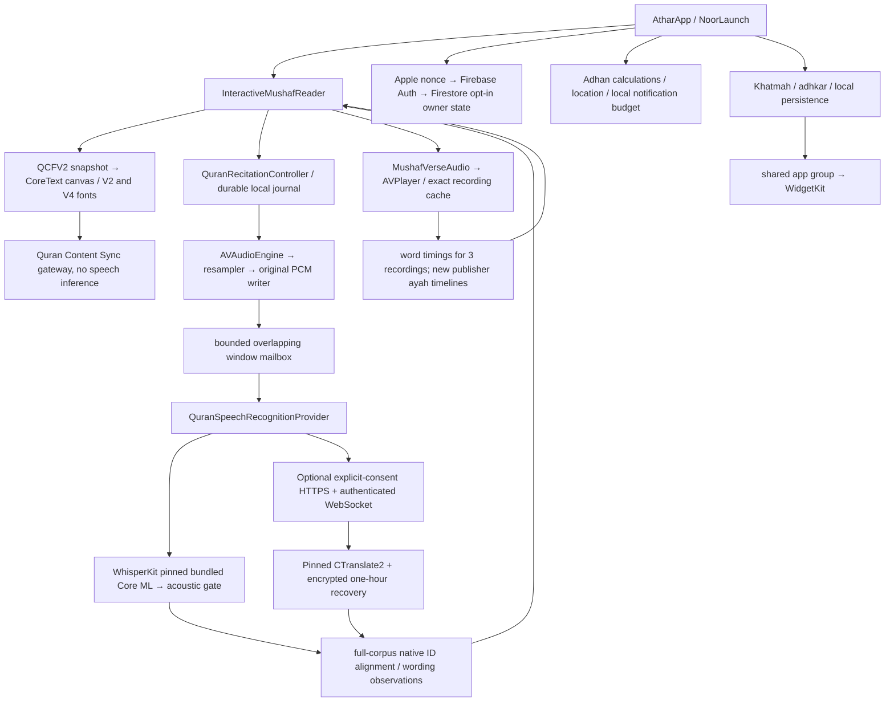

# Engineering audit — 18 October 2026

This is a working audit, not production acceptance. The source inventory records
478 tracked source/config/test files at base `00e2612`. Runtime observations below
are explicitly separated from static inspection. New timing/backend changes after
that base require their own verification. No whole-product completion is claimed.

## Current dependency graph

## Confirmed findings and correction status

| ID / severity | Evidence, root cause and reproduction | Correction / verification |
|---|---|---|
| R01 high | Full-surah catalogue uses a different recording from per-ayah word timelines. `MushafVerseAudio` only loaded word times for EveryAyah. Select a full-surah voice: no moving highlight. | New exact-folder publisher ayah timeline import. 1,816 structurally valid tracks, 122 rejected, no interpolation. Native playback verification pending; **not universal word timing**. |
| R02 high | Reader's former one-shot verse callback excluded every `hasSession`, including paused learner sessions. | `00e2612` follows published playback state instead and excludes actual listening only; selected native regression passed. |
| R03 high | Tajweed V4 fixed size23 was compared with original V2 size32 despite different font metrics. | Uniform page font size derives from actual CoreText authored-row extent. All604 pages in both themes passed native pixel/geometry checks at00e. No horizontal glyph distortion. |
| R04 medium | Hidden controls still reserved top/bottom reading height and duplicated horizontal padding. | Actual viewport now reclaims tool area. Native UI checks height growth and margin-tap restoration, with original XCTest PNGs. |
| R05 high | Full-corpus reference binding shared an actor with model loading/inference; a non-cooperative SDK decode could delay mic startup. | Separate immutable reference actor. Cancellation/binding lifecycle regression passed in00e. Physical input start latency remains unmeasured. |
| R06 high | Full-corpus alignment was executed on MainActor for each window. | Cancellable detached alignment on value state, with revision checks before persistence/reveal. Native alignment tests passed; no device energy benchmark yet. |
| R07 high | Existing `server/quran-sync` only proxies content. No authenticated speech endpoint, server session store, transport recovery or server inference exists. | Implement separate bounded inference service; preserve working local provider. Deployment and native-to-staging verification require an actual authorized endpoint. |
| R08 high | Whole-surah playback always starts at the track beginning; picker appropriately warns. Catalogue identity alone does not permit selected-ayah seeking. | New exact ayah timelines can support verified seeks; untimed recordings must continue to disclose beginning-of-surah behavior. Do not fabricate offsets. |
| R09 high | Build23 uploaded/processed, but automatic internal group manually assigning returns Apple error. | Future private workflow no longer submits beta review/manual group association. Existing23 not rebuilt. Apple login/installation availability still requires confirmation. |
| R10 high | Prior raw AVPlayer/AVAudioPlayer controls hung in Simulator HAL; real input/recognition accuracy not proven. | Preserve actual failed receipts. Successful public PCM recognizer/canvas/UI tests are narrower evidence; device testing is still required. |
| R11 high | Existing wording confidence is a model posterior, not a calibrated probability of a religious/recitation mistake. No reviewer-labeled Tajweed acceptance set. | Capability flags remain false; uncertain ASR is not a confirmed pronunciation/Tajweed error. Add evaluation and event contracts without inventing calibration. |
| R12 high | Real continuous public PCM test failed: partial «قل أعوذ» after112:1 selected113:1 before the distinctive word of114:1 arrived. The local two-word rule used±12 corpus words as a passage prior. | Restrict short continuation anchors to the current/actual next pending verse in both Swift and Python; other passages retain the unique3-group requirement. The latest real3-window test reports112:1→114:1 with no113 jump;112:2 abstains after genuine ASR errors, rather than inventing a confirmation. New Swift regression still needs native execution. |
| R13 high | After an unacknowledged remote window, continuing with different PCM under the same sequence could mismatch a remotely committed result or skip unprocessed audio. | Exact-byte reconnect retry; unresolved failure halts only tracking, preserves independent local capture, and resets transport state on a new take. Client source added, native network fault test pending. |
| R14 high | A configured HTTP endpoint could otherwise redirect a POST containing an identity token. | Native HTTP redirect delegate rejects redirects; endpoint requires explicit HTTPS configuration and consent/policy version, bounded responses and ephemeral session. Native execution pending. |
| R15 high | First concurrent requests for a previously absent rate bucket could race: a SELECT row lock does not protect a missing row. | Atomic conditional PostgreSQL/SQLite upsert;32 simultaneous local requests admit exactly7 and reset at expiry. Actual PostgreSQL deployment still pending. |
| R16 high | Model-ready alone could advertise a healthy service after an SDK decode exceeded its deadline while retaining compute. A Windows timer/clock-resolution regression exposed reliance on elapsed time alone. | Explicit overdue-decode state refuses readiness and new sessions until real completion; deterministic worker-release test passed. |

## Feature trace and remaining evidence

| Feature | Real implementation | Status / limits |
|---|---|---|
| Quran content | pinned Tanzil6236 ayahs +112 separate basmalas, QCFV2 snapshot/script/native glyph correspondence | Exact text verification passed. Native all604 rendering at00e passed; specialist printed-page/religious review not supplied. |
| Recognition | bundled model, AVAudioEngine/resampler, WebRTC VAD, word-local confidence/audio gate, native alignment and local evidence journal | Functional pipeline exists. Two public PCM transitions tested; this is not WER/CER/false-alert evaluation on unseen learner recordings. |
| Account | Apple SHA256 nonce, Firebase verification, bounded operations; Firestore two owner-only private docs | Existing cloud sync is opt-in. Deletion marker and transaction prevent stale writes; production rules deployment not established by source alone. |
| Deletion | Apple reauthentication/revoke, tombstone + cloud data batch delete, auth user delete, retry state | Preserves local data explicitly; no server inference account yet at audit base. Do not replace this with a disconnected new identity. |
| Playback/cache | AVPlayer actual clock, exact recording-key URL validation, auto cache on heard start | No download-all requirement. Existing3 word timing datasets are incomplete and cannot be reused for other bitrates. |
| Khatmah | KhatmahStore, home continuation, read-only daily range, progress persistence | Existing typed tests in repository; not rerun as part of53 selected00e cases. |
| Prayer/location | Adhan1.5.0, automatic profile, explicit permission, timezone-aware schedules | Actual iOS notification permission/background execution cannot be forced. Long audio and horizon limits must remain disclosed. |
| Reminders | UNUserNotificationCenter, finite pending-request budget, five-minute repeating salawat and fixed20min after-prayer messages | Local scheduling exists. Lock-screen timing/delivery determined by iOS, not proven from simulator rendering. |
| Adhkar/tasbih | distinct morning/evening content filters, counters and reset-day state | Source present with targeted tests; full reading/accessibility journey pending current final build. |
| Widgets | shared app group bridge + timelines; target entitlements/signing | Code and matching profiles exist; current binary on Home/Lock Screen not visually validated. |
| Screen Time | authorized FamilyControls/DeviceActivity extensions, persisted plan ownership | Entitlement/device authorization dependent; never promise unconditional OS blocking. |
| Accessibility | RTL locale, Reduce Motion, canvas custom actions, selection/controls labels | Fixed scripture grid is intentional; VoiceOver and large UI text need device audit, not claimed fully compliant. |

## Architecture decision

Use one Python inference service with FastAPI/WebSockets, SQLAlchemy durable
session/token/event state and a bounded local CTranslate2 worker. PostgreSQL is
the production database; SQLite is a local test/single-process option. No Redis,
GPU fleet, audio object store or queue cluster is justified by measured demand.
Start with one service process and explicit admission limits. Multiple replicas
require distributed admission before any capacity claim. The existing Firebase
Apple identity remains supported through server-side ID token verification;
direct Apple identity exchange additionally needs a one-use server nonce.

Audio is transient memory for inference and is never written to server storage.
Recovery metadata/events are encrypted and expire. Remote inference must be an
explicit user choice with a configured HTTPS endpoint; bundled local recognition
remains functional when offline. No guessed endpoint, hidden audio upload or
new infrastructure purchase is authorized by implementing source code.

## Acceptance still outstanding

Full application regressions, real iPhone microphone measurements, calibrated
mistake/Tajweed evaluation, all-reader word timing, native client→deployed backend,
PostgreSQL deployment/restore/load exercise, reviewer content approval, and final
TestFlight availability. A local backend test or compilation cannot clear these.

## User-directed inline-only recitation

Latest product instruction removes standalone memorization/setup/history routes.
The microphone, hide/reveal, provisional tracking and optional contextual controls
remain in the same Mushaf. Legacy data/journals are preserved; settings retain
explicit audio deletion/export controls. Recovery storage is internal evidence,
not a score/history screen. Old navigation tests now assert the requested absence;
real capture/background/recovery tests remain in the full microphone suite.
These UI changes have not yet passed a current native build. Native attempt
6ad409b17550aed8108fb533 failed before tests because of the720/600 deadline
contract mismatch; corrected helper and early preflight have local regression
coverage. Never relabel that failed run as an application or acoustic pass.
